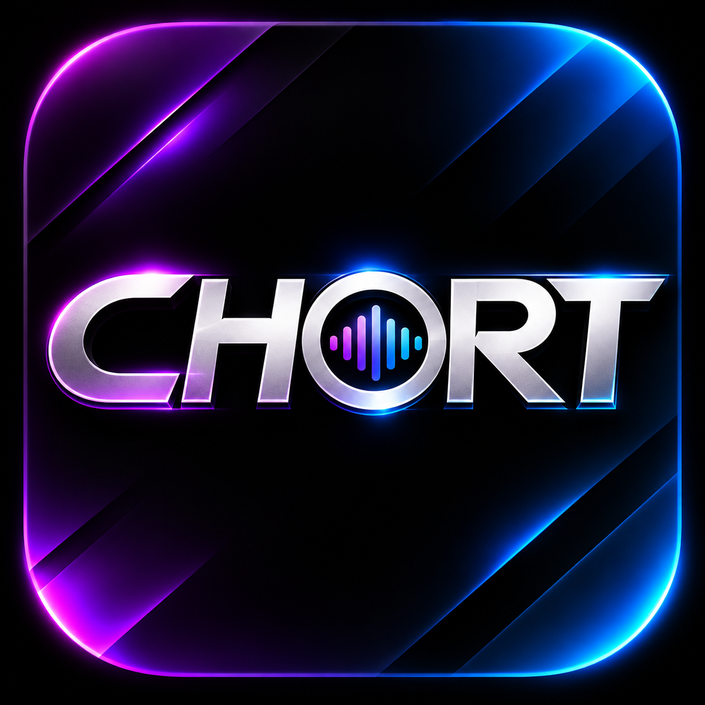
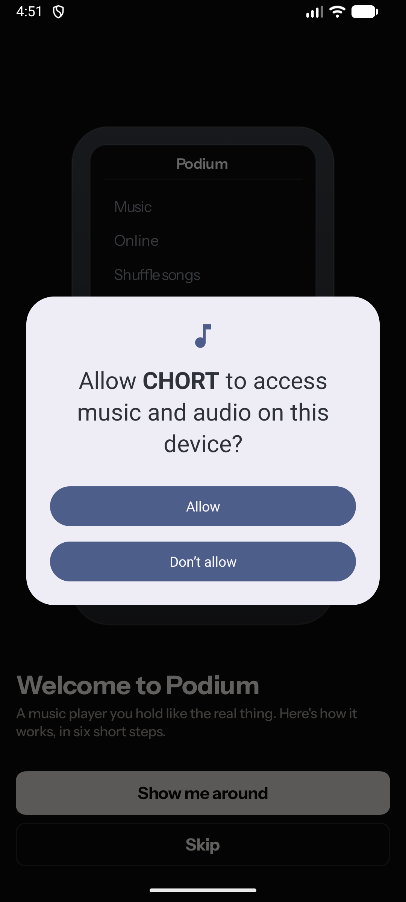
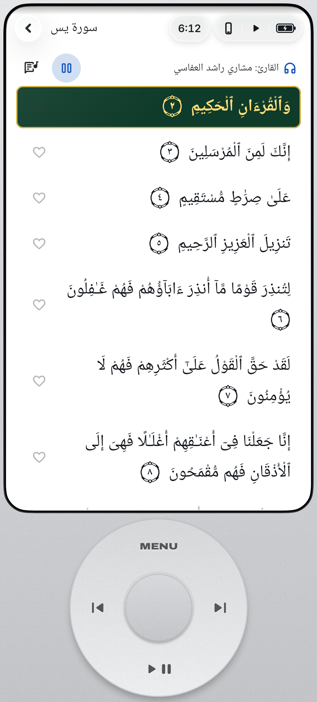

<p align="center">
  
</p>

<h1 align="center">CHORT</h1>

<p align="center"><b>The wheel is back.</b> An all-in-one retro Click Wheel media player &amp; companion for Android.</p>

<p align="center">
  <a href="https://github.com/Hamza-Houaoui/chort/releases/latest"></a>
  <a href="https://github.com/Hamza-Houaoui/chort/releases/latest"></a>
  <a href="LICENSE"></a>
  
</p>

<p align="center"><a href="https://github.com/Hamza-Houaoui/chort/releases/latest">Releases</a>&nbsp;&nbsp;|&nbsp;&nbsp;<a href="docs/README.md">Documentation</a></p>

---

Every media app looks the same. **CHORT** brings back the Click Wheel: one wheel to glide, one button to choose, and everything about the device yours to customize. Local music, offline downloads, YT Music, YouTube, SoundCloud, Radio, Podcasts, Holy Quran, Books, Gallery, Clock &amp; WakeIQ Alarms, Voice Memos, Listen Together, and Insights — all inside one clean, private, ad-free retro device.

<p align="center">
  
  &nbsp;&nbsp;
  
</p>

## Download

1. Download the latest APK from **[Releases](https://github.com/Hamza-Houaoui/chort/releases/latest)**.
2. Open it on your Android phone (Android 10 or later).
3. Open **CHORT** and turn the wheel.

## What's Inside

| Feature | Description |
|---|---|
| **One Click Wheel** | Turn to move, press to choose, Menu to go back — with crisp haptic clicks and dynamic header icons (including live account avatars for YT Music &amp; SoundCloud). |
| **Music &amp; Offline Downloads** | Local library + in-app offline downloads merged seamlessly across **Downloads**, **3D Cover Flow**, **Albums**, **Artists**, **Songs**, **Favorites**, and **Playlists**. |
| **YT Music** | Built-in online catalogue, search, likes, playlists, history, and ad-free background streaming. |
| **YouTube + Instant Audio Handoff** | Ad-blocked YouTube browser with wheel controls; **Hold OK** on any video to immediately hand it off to the audio-only player from the exact same timestamp. |
| **SoundCloud** | Stream, Likes, Playlists, Top 50 Charts, Search, and full **Account Profile** card with HD avatar and stats. |
| **Radio + Cover Flow Reorder** | Live worldwide &amp; Tunisian FM stations, custom stations, mini-browser, and **Hold OK** in Radio Cover Flow to drag/reorder favorite stations with the wheel. |
| **Podcasts** | Apple Podcasts, YouTube Music Podcasts, and RSS subscriptions with episode playback. |
| **Holy Quran (القرآن الكريم)** | All 114 Surahs with Uthmanic Mosshaf, synchronized Ayah highlighting, automatic Surah-to-Surah transition, reciters, Tafsir/translations, bookmarks, and search. |
| **Books** | Cover Flow reader (PDF, EPUB, TXT, DOC, FB2, CBZ, MD) with folder extension filters, long-press share/delete/favorite, reading themes, and bookmarks. |
| **Gallery &amp; TeleDrop** | 3D Cover Flow for photos &amp; videos, built-in photo editor, long-press share to any app, and **TeleDrop Telegram Sync** with themed clipboard paste buttons. |
| **Clock &amp; WakeIQ** | World Clock, **WakeIQ Smart Music Alarms** with live animated weather report &amp; mini player, Stopwatch with OK-button loop/lap recording, and a 24-hour Timer. |
| **Insights (Activity Report)** | 3D Cover Flow of large themed report cards tracking real-time listening, watching, and reading across all 9 tabs (`Today`, `Week`, `Month`, `All Time`). |
| **Voice Memos &amp; Listen Together** | Built-in voice recorder and local-network synchronized listening with friends. |
| **5 Languages** | Full support for English, Arabic, French, Turkish, and Russian. |
| **Private** | Zero ads, zero analytics, zero tracking. |

## Make It Yours (CHORT ART)

- **17 typefaces** for the display plus **7 typefaces for synchronized lyrics**.
- **16.7 million colours** — dial any body finish live with the wheel.
- **Finishes &amp; Display Themes:** Glass, Carbon, Bone, Silver, Steel Gray, Burgundy, Glacier Blue, or custom photo backgrounds.
- **Glitter &amp; Stickers:** Real tilt-responsive glitter and custom stickers cut from your photos.

## Build From Source

Requirements: JDK 21 and the Android SDK.

```bash
./gradlew :app:assembleDebug
./gradlew :app:assembleRelease
```

## License

**CHORT** is free software, licensed under the [GNU General Public License v3.0](LICENSE).
